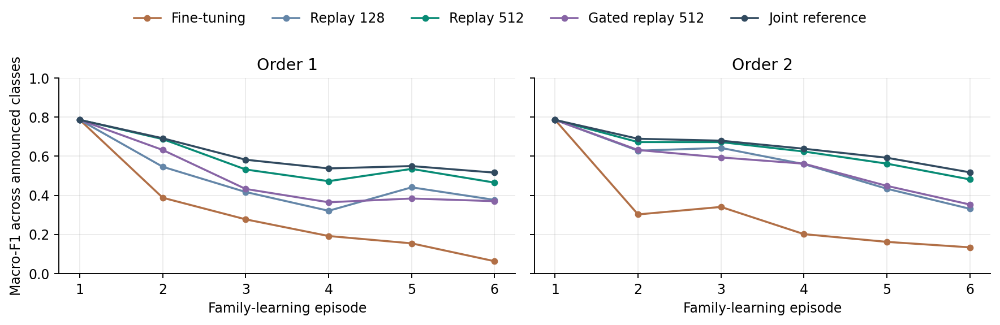
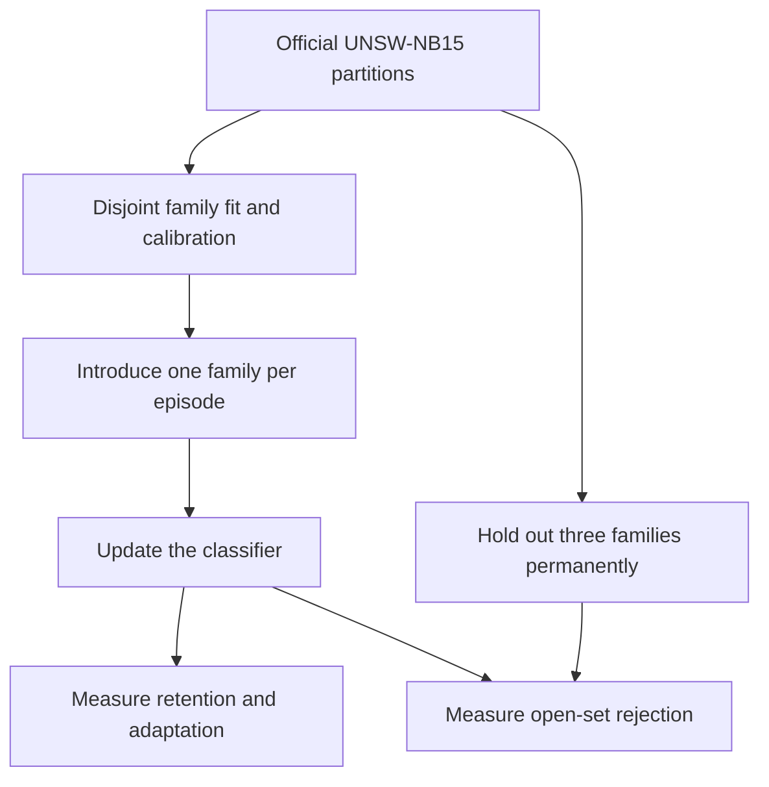

# Continual Learning for Emerging Threat Families

Measure how quickly an intrusion detector learns new labels, how much it forgets, and whether it can reject families it has never seen. The study uses feature-only UNSW-NB15 examples, six learning episodes in two orders, and a fixed holdout.

## Results

A 512-row replay buffer cut average forgetting from **82.42 to 30.44 percentage points** on the primary order. Final macro-F1 rose from **0.063 to 0.465**, still below the **0.516** cumulative-data reference. Consolidation and distillation were weak by themselves. Combining both with replay underperformed plain replay at the same memory cap.

| Policy | Final macro-F1, order 1 | Final macro-F1, order 2 | Forgetting, order 1 |
|---|---:|---:|---:|
| Fine-tuning | 0.063 | 0.134 | 82.42 pp |
| Replay 128 | 0.377 | 0.331 | 45.67 pp |
| Replay 512 | 0.465 | 0.482 | 30.44 pp |
| Hybrid 512 | 0.398 | 0.398 | 35.47 pp |
| Gated replay 512 | 0.370 | 0.353 | 39.86 pp |
| Joint-data reference | 0.516 | 0.518 | 16.65 pp |

Drift gating reduced the primary-order budget from 42 to 17 epochs, with lower final macro-F1. In the primary-order Replay 512 arm, maximum-softmax novelty scored **0.675 AUROC** and diagonal centroid distance **0.507**. The centroid threshold rejected only **4.81%** of permanently held-out examples at **4.12%** false positives among known examples.



## Experiment design



Compare nine policies across five seeds and two orders, with disjoint model-fitting, calibration, and test rows. Keep a fixed architecture with masked output classes and audit the number of stored examples. Measure macro-F1, per-class recall, forgetting, backward transfer, a few-shot forward-transfer diagnostic, and open-set AP and AUROC. The feature-only dataset has no timestamps in these partitions. The family sequences are constructed, and omitted families are proxies for unfamiliar threats.

## Reproduce

```sh
python -m venv .venv
source .venv/bin/activate
python -m pip install torch==2.15.0 --index-url https://download.pytorch.org/whl/cpu
python -m pip install -e '.[report]'
OPENBLAS_NUM_THREADS=1 OMP_NUM_THREADS=1 python -m unittest discover -s tests -v
python scripts/download_unsw.py
OPENBLAS_NUM_THREADS=1 OMP_NUM_THREADS=1 python -m continual.benchmark
gzip -nc results/study.json > results/study.json.gz
python scripts/report.py
```

[Research report](results/continual-threat-detection-report.pdf) · [Methodology and references](docs/METHODOLOGY.md) · [Interview practice and résumé drafts](docs/INTERVIEW.md)

All measured experiment rows and intervals are available in `results/study.json.gz`. The repository contains no raw datasets or model binaries. Academic data use is subject to the dataset authors' terms. Code development was AI-assisted.
